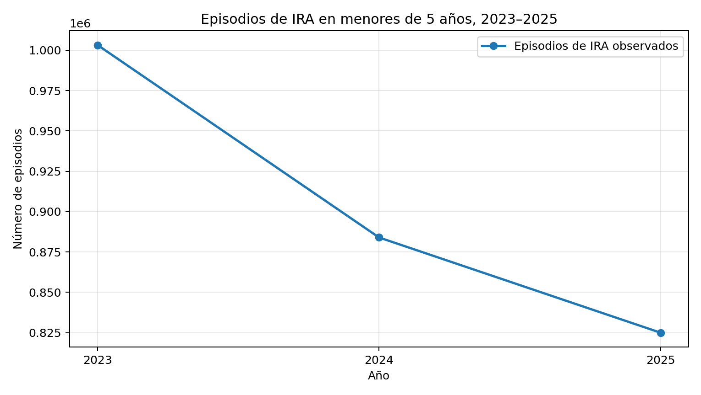
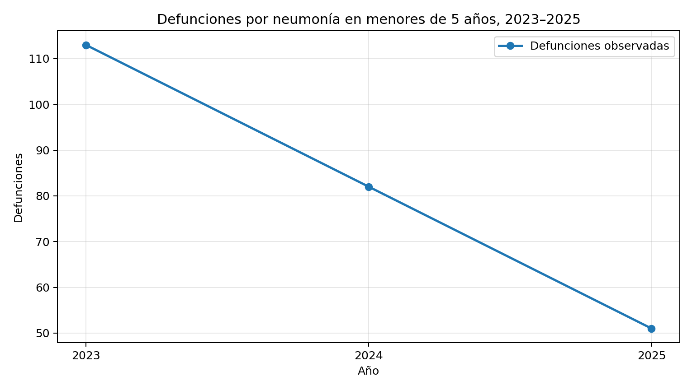
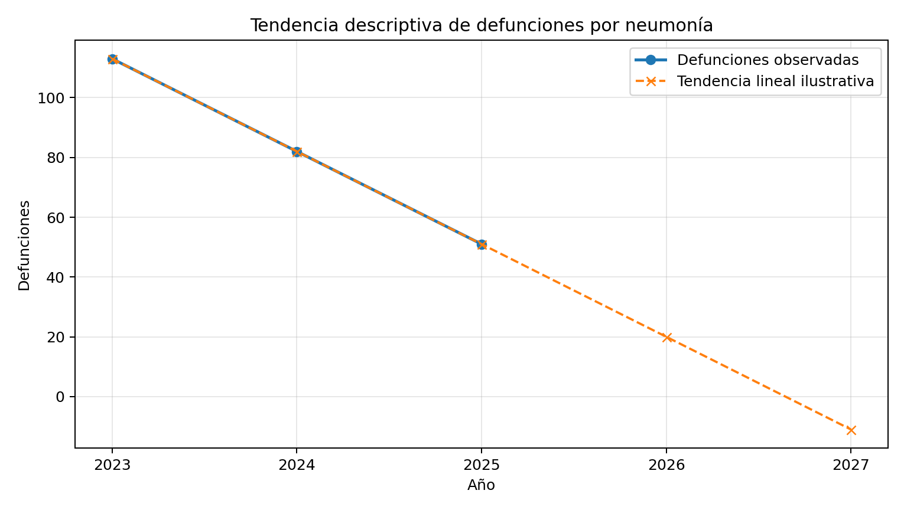

# Infecciones Respiratorias Agudas (IRA) y neumonía en menores de 5 años en el Perú

## Challenge 2 — Fundamentos de IA y Búsqueda

### 1. Descripción del problema

El caso analiza la disminución reportada de episodios de infecciones respiratorias agudas (IRA) y de defunciones por neumonía en menores de cinco años en el Perú entre 2023 y 2025. El objetivo es organizar la información disponible y representar un proceso de análisis que permita comparar alternativas preventivas y observar tendencias, sin asumir que los datos prueban causalidad.

**Problema:** identificar cómo organizar y analizar la información reportada para apoyar la priorización de acciones preventivas y de respuesta sanitaria.

### 2. Datos reportados en el afiche

| Indicador | 2023 | 2024 | 2025 |
|---|---:|---:|---:|
| Episodios de IRA en menores de 5 años | 1,003,178 | 883,959 | 824,978 |
| Defunciones por neumonía en menores de 5 años | 113 | 82 | 51 |

El afiche reporta una disminución de episodios de IRA y de defunciones por neumonía. La tendencia observada no demuestra por sí sola que una medida específica haya causado la reducción.

### 3. Bloque 1 — Pipeline de razonamiento, búsqueda y resultados

#### 3.1 Representación del problema y espacio de estados

El espacio de estados representa las etapas de análisis desde la información inicial hasta la comparación de alternativas.

- **Estado inicial:** datos reportados para los años 2023–2025.
- **Estados intermedios:** organizar indicadores, revisar tendencias, identificar vacíos de información y comparar alternativas preventivas.
- **Estado objetivo:** producir un resumen trazable de los indicadores y una comparación orientativa que ayude a discutir prioridades.
- **Acciones:** calcular variaciones, visualizar series temporales y comparar alternativas.
- **Restricciones:** no se dispone en el afiche de cobertura regional real, costos detallados, distribución territorial, factores climáticos/socioeconómicos ni evidencia causal.
- **Criterios ilustrativos:** prevención, factibilidad y rapidez de respuesta.

```python
espacio_estados = {
    "Estado inicial": "Datos reportados de IRA y neumonía (2023–2025)",
    "Estados intermedios": [
        "Organizar indicadores",
        "Analizar tendencias",
        "Identificar información no reportada",
        "Comparar alternativas preventivas"
    ],
    "Estado objetivo": "Resumen de resultados y prioridades para revisión"
}
```

#### 3.2 Búsqueda y comparación de alternativas

El siguiente ejemplo representa una comparación didáctica. Las puntuaciones son supuestos académicos y no resultados oficiales del MINSA.

```python
import pandas as pd

alternativas = pd.DataFrame({
    "Alternativa": [
        "Vacunación y campañas",
        "Higiene y ventilación",
        "Atención oportuna"
    ],
    "Prevención": [5, 4, 2],
    "Factibilidad": [4, 5, 3],
    "Rapidez de respuesta": [3, 4, 5]
})

pesos = {
    "Prevención": 0.50,
    "Factibilidad": 0.25,
    "Rapidez de respuesta": 0.25
}

alternativas["Puntuación ilustrativa"] = sum(
    alternativas[columna] * peso
    for columna, peso in pesos.items()
)
alternativas = alternativas.sort_values(
    "Puntuación ilustrativa", ascending=False
)
display(alternativas)
```

**Interpretación:** la comparación permite ordenar opciones según los criterios elegidos. El resultado depende de los pesos y puntuaciones definidos; por ello, no debe interpretarse como una recomendación sanitaria oficial.

#### 3.3 Gráficos de resultados

**Episodios de IRA, 2023–2025**



**Defunciones por neumonía, 2023–2025**



### 4. Bloque 2 — Pipeline de predicción y gráfica

Este bloque usa una regresión lineal simple como demostración de cómo ajustar una tendencia sobre los valores reportados de defunciones. Debido a que solo hay tres observaciones anuales, cualquier extensión hacia años futuros es **exploratoria e ilustrativa**, no una predicción epidemiológica validada.

```python
import numpy as np
import matplotlib.pyplot as plt
from sklearn.linear_model import LinearRegression

# Variables observadas del caso
anios = np.array([2023, 2024, 2025]).reshape(-1, 1)
defunciones_neumonia = np.array([113, 82, 51])

modelo = LinearRegression()
modelo.fit(anios, defunciones_neumonia)

anios_grafica = np.array([2023, 2024, 2025, 2026, 2027]).reshape(-1, 1)
predicciones = modelo.predict(anios_grafica)

plt.figure(figsize=(8.5, 4.8))
plt.plot(
    anios.ravel(), defunciones_neumonia,
    marker="o", label="Defunciones observadas"
)
plt.plot(
    anios_grafica.ravel(), predicciones,
    marker="x", linestyle="--", label="Tendencia lineal ilustrativa"
)
plt.title("Tendencia descriptiva de defunciones por neumonía")
plt.xlabel("Año")
plt.ylabel("Defunciones")
plt.xticks(anios_grafica.ravel())
plt.grid(True, alpha=0.3)
plt.legend()
plt.tight_layout()
plt.show()

print("Pendiente del modelo:", round(modelo.coef_[0], 2))
print("Intercepto del modelo:", round(modelo.intercept_, 2))
```

**Interpretación:** la línea resume una tendencia descendente en los tres datos disponibles. No incorpora cobertura de vacunación, cambios en vigilancia, distribución regional, condiciones socioeconómicas ni otros factores; por tanto, no debe usarse para anticipar cifras reales ni para decidir intervenciones.



### 5. Variables observables y vacíos de información

**Variables observables en el afiche**
- Número de episodios de IRA.
- Número de defunciones por neumonía.
- Año de observación.
- Disponibilidad reportada de vacunas.
- Campañas preventivas, recursos sanitarios y poblaciones objetivo mencionadas.

**Aspectos no reportados en el afiche**
- Cobertura real de vacunación.
- Distribución regional de casos y defunciones.
- Costos de las intervenciones.
- Impacto individual de cada medida.
- Factores climáticos y socioeconómicos.
- Relación causal demostrada entre las medidas y los resultados.

### 6. Conclusiones

1. Los datos del afiche muestran una disminución de episodios de IRA y defunciones por neumonía entre 2023 y 2025.
2. El espacio de estados organiza el proceso desde los datos iniciales hasta la comparación de alternativas.
3. La búsqueda permite comparar opciones según criterios explícitos, pero el resultado depende de las puntuaciones y pesos utilizados.
4. La regresión lineal representa una tendencia descriptiva, no una predicción oficial ni evidencia de causalidad.
5. Para formular prioridades sanitarias reales se necesita información oficial más detallada y evaluación por especialistas.

### 7. Fuente y transparencia

**Fuente indicada en el afiche:** Ministerio de Salud del Perú (MINSA), 2024. El afiche compartido menciona la noticia sobre disminución de episodios de IRA y muertes por neumonía en menores de cinco años. Antes de usar las cifras para decisiones reales, debe comprobarse la publicación oficial y su metodología.

**Transparencia metodológica:** los datos de 2023–2025 se transcribieron del afiche proporcionado por el estudiante. Las puntuaciones de alternativas y la regresión lineal son demostraciones académicas; no constituyen resultados oficiales ni permiten afirmar causalidad.
